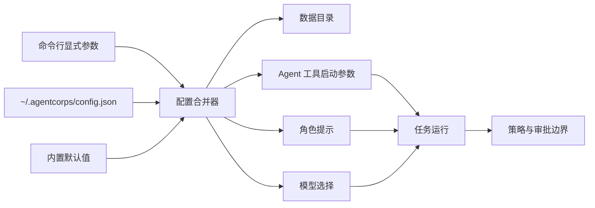

# 统一配置

AgentCorps 从 `~/.agentcorps/config.json` 自动读取本地配置。也可以通过 `--config PATH` 指定一个配置文件；`--agents-config PATH` 继续作为旧版外部工具清单入口保留。

## 优先级

同一个设置按以下顺序生效：

1. 命令行显式参数；
2. `--config` 指定的配置，或自动发现的 `~/.agentcorps/config.json`；
3. AgentCorps 内置默认值。

`--data-dir` 只覆盖数据目录。AgentCorps 配置不会覆盖厂商工具自己的认证和 Provider 配置。

## 配置示例

下面的示例只包含启动方式、运行参数、模型选择、工作目录和角色提示，不包含 API Key、访问令牌或其他凭据：

```json
{
  "version": 1,
  "paths": {
    "dataDir": "~/.agentcorps",
    "workspaceRoot": "~/workspace"
  },
  "defaults": {
    "agent": "kimi",
    "model": "kimi-code",
    "role": "developer",
    "instructions": "优先使用中文回答，完成后报告实际执行的验证命令"
  },
  "tools": {
    "kimi": {
      "command": "kimi",
      "cwd": "~/workspace",
      "timeoutMs": 600000
    }
  },
  "git": {
    "allowWrite": true,
    "requireApproval": true
  },
  "browser": {
    "endpoint": "http://127.0.0.1:9222",
    "allowControl": true,
    "requireApproval": true,
    "network": "allowlist",
    "allowedHosts": ["localhost"]
  },
  "roles": {
    "release-reviewer": {
      "displayName": "Release reviewer",
      "description": "Review release readiness",
      "prompt": "检查发布风险、回归和验证证据；只报告可以定位和复现的问题。"
    }
  }
}
```

如需注册不在内置清单中的工具，可以在同一个文件中加入 `toolDefinitions`。工具定义只描述可执行文件和参数，不承载认证信息：

```json
{
  "version": 1,
  "defaults": { "agent": "local-reviewer" },
  "toolDefinitions": [
    {
      "id": "local-reviewer",
      "displayName": "Local reviewer",
      "command": "reviewer",
      "args": ["--json"],
      "outputFormat": "text",
      "promptPlacement": "argument",
      "modelFlag": "--model"
    }
  ]
}
```

## 路径和安全边界

- `~` 会展开为当前用户的家目录；相对路径相对于 CLI 启动目录解析。
- 配置文件必须是版本为 `1` 的 JSON；未知字段、错误类型、空角色文本、非法参数和超过 1 MiB 的文件都会被拒绝。
- 配置中的命令被视为本地管理员明确配置的可执行文件，AgentCorps 不把角色提示词当作权限。
- Codex、Claude Code、Kimi、Qwen 等工具的登录信息和 Provider 设置继续由各自原生配置管理，不复制到 AgentCorps 配置。
- `cwd` 只设置 Agent 子进程的工作目录；终端、Git、浏览器等高风险能力仍须经过独立的策略和审批检查。
- `paths.workspaceRoot` 作为桌面文件浏览和 Git Gateway 的默认工作区边界；Git 写入还需要 `git.allowWrite: true`，并默认要求 `git.requireApproval: true`。
- `browser` 配置控制 DevTools 端点、浏览器控制开关、审批模式、网络模式和目标主机白名单；浏览器控制还会经过 Gateway 安全策略。

## 设计图



## 验证

隔离临时 `HOME` 的 CLI 测试会验证：不传 `--agents-config` 时自动读取家目录配置、配置中的工具和工作目录生效、配置角色和运行指令进入 Agent 提示词，以及 `--model` 可以覆盖配置中的模型。
