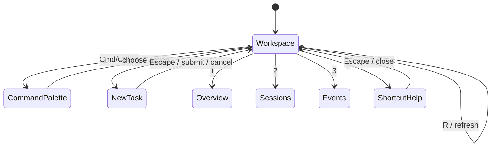

# 控制台快捷键

控制台提供一组不依赖鼠标的基础操作。快捷键只在页面主体上生效；正在输入框、文本区域或下拉框中编辑内容时，字母和数字快捷键会被忽略。`Escape` 可以关闭快捷键浮层或当前对话框，`Command+K` 和 `Control+K` 都可打开命令面板。

| 按键 | 操作 |
| --- | --- |
| `N` | 新建任务 |
| `1` | 切换到概览 |
| `2` | 切换到会话 |
| `3` | 切换到事件流 |
| `4` | 切换到文件浏览 |
| `5` | 切换到 Git |
| `6` | 切换到 Terminal |
| `7` | 切换到 Browser |
| `8` | 切换到 Usage 调用统计和日志 |
| `R` | 刷新运行时数据 |
| `Command+K` / `Control+K` | 打开命令面板 |
| `?` | 查看快捷键帮助 |
| `Escape` | 关闭浮层或对话框 |

## 交互设计

快捷键只触发已有的控制台动作，不绕过网关、任务状态机、审批策略或认证。刷新仍然使用当前连接和当前令牌，创建任务仍然使用现有的任务创建接口。
