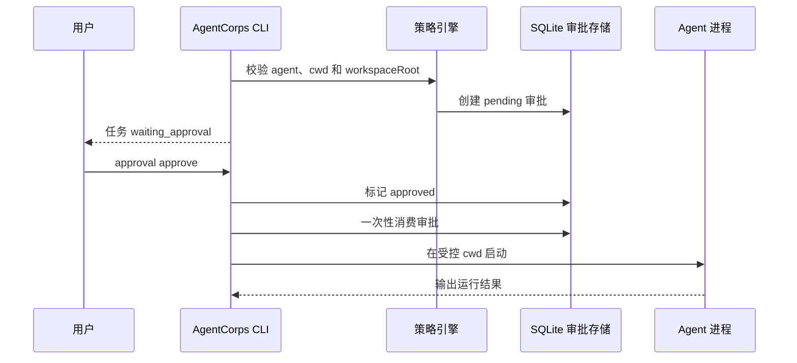

# Agent 工作目录与审批控制

每个 Agent 工具可以在 `~/.agentcorps/config.json` 的 `tools.<agent>` 下配置工作目录和审批模式。控制只影响 AgentCorps 启动和调度边界，不改变厂商工具自己的认证配置。

```json
{
  "version": 1,
  "paths": { "dataDir": "~/.agentcorps" },
  "defaults": { "agent": "kimi" },
  "tools": {
    "kimi": {
      "cwd": "~/workspace/project",
      "workspaceRoot": "~/workspace",
      "approvalMode": "always",
      "timeoutMs": 600000
    }
  }
}
```

## 工作目录

- `cwd` 是 Agent 子进程实际启动目录。
- `workspaceRoot` 是工作区安全边界；当未配置时，默认使用 `cwd`，再回退到 CLI 启动目录。
- `cwd` 必须位于 `workspaceRoot` 内，否则运行会被拒绝。
- 命令行 `--workspace-root PATH` 可以覆盖配置中的工作区根目录；命令行显式参数优先于家目录配置。
- 工作目录不会自动赋予终端、Git、文件或网络权限；这些能力仍由各自的策略和审批控制。

## 审批生命周期

`approvalMode` 支持：

- `never`：保持现有的直接运行行为，默认值。
- `always`：Agent 开始执行前创建一个 `process.exec` 审批。任务进入 `waiting_approval`，不会启动子进程。

CLI 可以完成本地审批：

```bash
agentcorps approval list --data-dir PATH
agentcorps approval approve APPROVAL_ID --decided-by operator --data-dir PATH
agentcorps approval deny APPROVAL_ID --decided-by operator --data-dir PATH
agentcorps task run TASK_ID --approval-mode always --data-dir PATH
```

批准是一次性消费的，重新运行等待审批的任务时会校验任务、Agent、工作目录和工作区根目录对应的请求；成功启动后该审批变成 `consumed`。审批和策略审计使用同一个 SQLite 数据库，并保留过期时间。

## 设计图



默认 `approvalMode: never` 是兼容模式；需要人工确认的部署应为每个高风险 Agent 设置 `approvalMode: always`，而不是依赖角色提示词表达权限。
