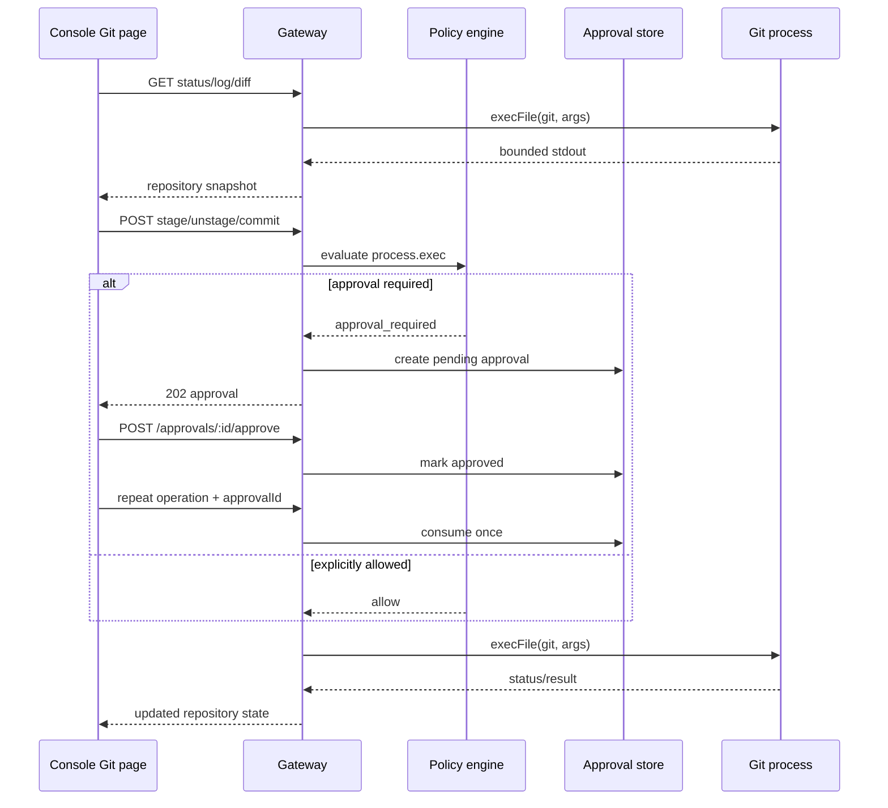

# Git 浏览与操作

AgentCorps 的 Git 能力由本地 Gateway 提供，控制台的 `Git` 页面只访问 Gateway，不直接调用浏览器或桌面端的 Git。Gateway 使用 `execFile('git', args)` 启动 Git，不经过 shell 拼接；仓库根目录由 `--workspace-root` 或 `config.paths.workspaceRoot` 指定。

## 启用 Gateway

只读浏览随 `serve` 一起启用：

```bash
agentcorps serve --workspace-root ~/workspace/project
```

写操作必须显式开启，并且默认需要审批：

```bash
agentcorps serve \
  --workspace-root ~/workspace/project \
  --git-write
```

配置文件可以表达同样的策略：

```json
{
  "version": 1,
  "paths": { "workspaceRoot": "~/workspace/project" },
  "git": {
    "allowWrite": true,
    "requireApproval": true
  }
}
```

命令行参数优先于配置：`--git-write` 开启写入，`--git-no-approval` 关闭 Git 写操作审批。关闭审批只适合受信任的本机自动化环境；远程 Gateway 应继续使用令牌、角色和审批。

## Gateway 接口

Gateway supports these routes:

- `GET /git/status` — current branch, upstream and worktree status.
- `GET /git/log?limit=20` — recent commits, with a limit from 1 to 100.
- `GET /git/diff?path=src/file.ts` — worktree diff, optionally narrowed to a relative path.
- `POST /git/stage` — request staging one or more relative paths.
- `POST /git/unstage` — request unstaging one or more relative paths.
- `POST /git/commit` — request committing staged content with a message from 1 to 500 characters.

写请求示例：

```json
{
  "taskId": "task-123",
  "paths": ["src/index.ts"]
}
```

提交请求使用 `message` 字段。首次写请求返回 `202` 和待审批记录；审批后将相同的 `taskId`、操作内容和返回的 `approvalId` 再提交一次。审批是一次性消费的，重复使用会被拒绝。没有 `allowWrite` 时写接口返回 `403`；启用审批但没有显式安全上下文时返回 `503`。

## 控制台行为

控制台 `Git` 页面提供：

- 分支、上游、变更数量和待审批数量概览；
- 变更文件列表和工作区差异；
- 最近提交记录；
- 选中文件的 `Stage selected` 和 `Unstage selected`；
- 提交消息输入和 `Commit staged changes`；
- 审批请求直接进入统一 Approval queue，批准后重新执行原操作。

快捷键 `5` 打开 Git 页面；`4` 打开文件浏览，`R` 刷新数据，`?` 打开快捷键帮助。输入框内不会触发页面快捷键。

## 安全边界

- Git 参数通过参数数组传给 Git，不通过 shell；路径参数只接受仓库根目录下的相对路径。
- Gateway 只把配置的工作区作为 Git 的当前目录；工作区之外的路径会被拒绝。
- 读接口要求 `read` 角色；写接口要求 `write` 角色；审批决定要求 `approve` 角色。
- 写操作默认经过 `process.exec` 策略检查和统一审批服务；审批记录保存在已有的内存或 SQLite 审批存储中。
- 审批记录绑定任务、能力和规范化操作描述，不能把一个 Git 操作的审批转用于另一个操作。
- Agent 角色提示词不授予 Git 权限；权限来自 Gateway 配置、安全策略和审批决定。
- Git 命令输出受默认 2 MiB、最大 16 MiB 的限制，避免把未受控的大量输出直接传到桌面端。

## 设计图



## 验证

Gateway 测试会在临时仓库中验证：分支名不依赖默认分支约定、状态和差异可读取、写入默认进入审批、批准后暂存成功、路径边界和请求格式有效。控制台测试会验证 Git 页面、差异、提交记录以及结构化写请求。构建和测试命令：

```bash
pnpm --filter @agentcorps/gateway build
pnpm --filter @agentcorps/gateway test
pnpm --filter @agentcorps/console build
pnpm --filter @agentcorps/console test
```
