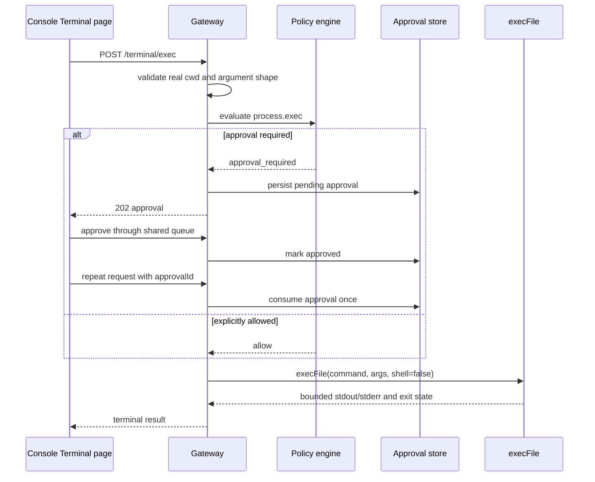

# 终端操作

AgentCorps 的 Terminal 页面通过 Gateway 在配置的工作区内执行单个可执行文件。执行使用 Node.js `execFile` 和参数数组，默认不经过 shell；终端命令不是由角色提示词授权，而是由 Gateway 配置、安全策略和审批服务共同控制。

## 启用

```bash
agentcorps serve \
  --workspace-root ~/workspace/project \
  --terminal-exec
```

默认每次执行都需要审批。受信任的本机自动化可以显式关闭审批：

```bash
agentcorps serve --workspace-root ~/workspace/project --terminal-exec --terminal-no-approval
```

配置文件也支持：

```json
{
  "version": 1,
  "paths": { "workspaceRoot": "~/workspace/project" },
  "terminal": {
    "allowExec": true,
    "requireApproval": true,
    "defaultTimeoutMs": 30000
  }
}
```

## 接口

`POST /terminal/exec` 接收以下 JSON 字段：

- `taskId`：必填，用于绑定审批和审计记录；
- `command`：必填，可执行文件名或绝对可执行文件路径；
- `args`：可选的字符串数组；
- `cwd`：可选的工作区相对目录，默认是工作区根目录；
- `timeoutMs`：可选，范围为 1 到 600000 毫秒；
- `approvalId`：批准后重复执行时使用的一次性审批 ID。

首次请求返回 `202` 和待审批记录。用户在控制台 Approval queue、CLI `approval approve` 或 Gateway 审批接口中批准后，控制台会自动用原操作和 `approvalId` 重试；CLI 或其他客户端需要自己重试。执行结果包含标准输出、标准错误、退出码、信号、是否超时和真实工作目录。

## 安全边界

- 参数通过 `execFile` 传入，命令字符串中不会解析 `;`、管道、重定向或命令替换。
- `cwd` 必须位于 `workspaceRoot` 内，并经过真实路径校验；越界目录在创建审批前就会被拒绝。
- Terminal 写接口要求 Gateway 的 `write` 角色；审批决定要求 `approve` 角色。
- `terminal.allowExec` 默认关闭；启用后默认仍要求 `process.exec` 策略通过并创建一次性审批。
- 单次输出默认限制 2 MiB，最大 16 MiB；默认超时 30 秒，最大 10 分钟。
- 命令失败仍返回结构化结果，不把普通退出码当成 Gateway 协议错误；参数、路径和策略错误返回 4xx。

## 控制台

快捷键 `6` 打开 Terminal 页面。页面要求填写命令和 JSON 字符串数组参数，显示审批状态、退出码、真实工作目录、标准输出和标准错误。命令输入框内不会触发页面快捷键。

## 设计图



## 验证

Gateway 测试使用临时工作区验证：审批前不执行、批准后保留工作目录、命令参数不经过 shell、越界 cwd 在审批前拒绝。CLI 配置测试验证终端策略字段和超时范围。控制台测试验证 Terminal 页面和结构化请求。相关命令：

```bash
pnpm --filter @agentcorps/gateway build
pnpm --filter @agentcorps/gateway test
pnpm --filter @agentcorps/cli build
pnpm --filter @agentcorps/cli test
pnpm --filter @agentcorps/console build
pnpm --filter @agentcorps/console test
```
