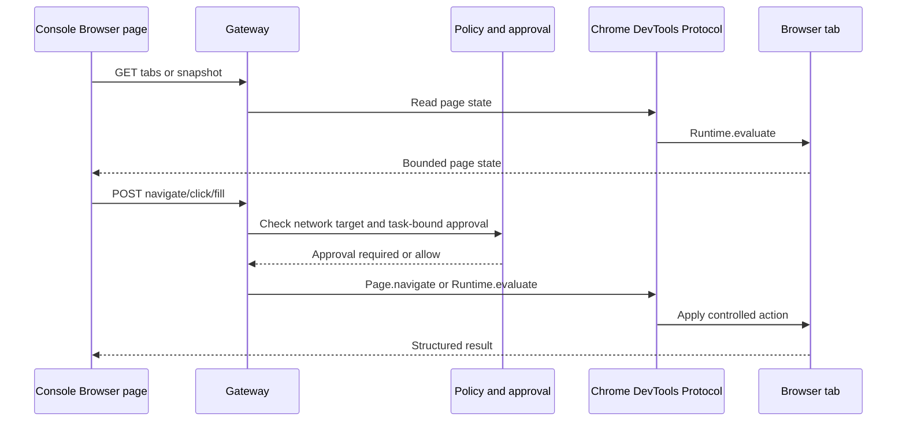

# 浏览器控制

AgentCorps 通过 Chrome DevTools Protocol（浏览器提供的本地调试协议）连接已经启动的 Chromium 浏览器。Gateway 只处理已打开的页面，不负责下载浏览器或自动绕过网站登录。

## 启用

启动 Chromium 时需要开启调试端口，例如：

```bash
chromium --remote-debugging-port=9222
agentcorps serve --browser-control --browser-network full --workspace-root ~/workspace
```

默认浏览器控制关闭。配置文件可以表达相同策略：

```json
{
  "version": 1,
  "browser": {
    "endpoint": "http://127.0.0.1:9222",
    "allowControl": true,
    "requireApproval": true,
    "network": "allowlist",
    "allowedHosts": ["example.com", "localhost"]
  }
}
```

`network` 为 `full` 时允许所有目标主机；`allowlist` 只允许 `allowedHosts` 中的主机；`none` 会拒绝需要网络策略的浏览器控制。浏览器读操作仍需要 Gateway 的 `read` 角色，控制操作需要 `write` 角色。

## Gateway 接口

- `GET /browser/tabs`：列出可控制的页面标签。
- `GET /browser/snapshot?tabId=ID`：读取页面标题、URL 和文本内容。
- `GET /browser/screenshot?tabId=ID`：获取有大小限制的 PNG 截图。
- `POST /browser/navigate`：导航到 HTTP 或 HTTPS 地址。
- `POST /browser/click`：按 CSS 选择器点击元素。
- `POST /browser/fill`：按 CSS 选择器填充输入元素并触发输入事件。

所有写入浏览器的请求都必须携带 `taskId`。启用审批时，首次请求返回待审批记录；批准后，客户端使用相同参数和 `approvalId` 重试。审批记录绑定任务、动作、目标主机，并且只消费一次。

## 安全边界

- 浏览器只接受 HTTP/HTTPS 导航地址，不接受带用户名或密码的 URL。
- 选择器和填充文本有长度限制，Gateway 不提供任意 JavaScript 执行接口。
- DevTools 端点仅应绑定本机或受保护网络；远程 Gateway 仍需要 bearer token 或设备身份认证。
- 页面文本和截图有大小限制，避免把大型页面直接传输到控制台。
- 浏览器控制的网络目标由安全策略的 `network` 和 `allowedHosts` 控制，审批不能绕过策略拒绝。

## 设计图



## 验证

Gateway 测试使用注入的 DevTools transport fixture 验证标签读取、页面快照、审批前不执行、批准后执行和一次性审批。控制台测试验证标签展示、导航请求和快捷键 `7`。真实 Chromium 连接还需要在目标机器上启动调试端口后手工验证。
