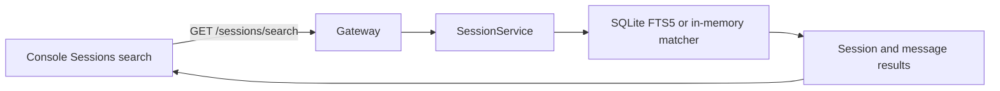

# 会话全文搜索

控制台 `Sessions` 页面和 Gateway 都支持在共享会话消息中搜索。搜索结果包含命中的会话、消息角色和完整消息内容；点击结果会切换到对应会话。

## Gateway 接口

`GET /sessions/search` 接收：

- `query`：必填的搜索短语，按空白分割后要求所有词命中；
- `workspaceId`：可选的工作区过滤；
- `role`：可选的 `user`、`agent`、`system` 或 `tool` 过滤；
- `limit`：可选，范围为 1 到 100，默认 50。

响应格式为 `{ "results": [{ "session": ..., "message": ... }] }`。归档会话不会出现在搜索结果中。

## 存储和性能

SQLite 会话存储使用 FTS5（SQLite 的全文检索扩展）建立消息索引；启动时会从现有消息表重建索引，因此旧数据库升级后也能搜索。JSONL 和内存存储使用同一套词项匹配规则，保证迁移和测试环境行为一致。

搜索只读取消息，不会修改会话。结果会限制在 100 条以内，搜索输入由 Gateway 要求非空，查询参数通过 URL 编码传输。

## 控制台行为

- 打开 `Sessions` 页面，在 `SEARCH MESSAGES` 输入框提交搜索；
- 搜索结果展示会话标题、工作区、消息角色和命中消息；
- 点击结果后，右侧消息区切换到对应会话；
- 搜索错误会保留当前会话内容，并以可读的错误提示显示。

## 设计图

## 验证

Session 包测试验证 JSONL 和 SQLite 的全文匹配、工作区过滤、角色过滤和归档过滤。Gateway 测试验证 HTTP 搜索路由。控制台测试验证搜索输入、结果展示和查询请求。
