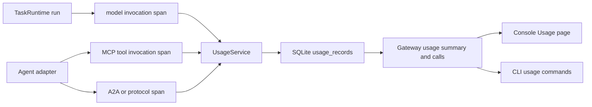

# GitHub Actions 与调用观测

## GitHub Actions 什么时候触发

`.github/workflows/quality.yml` 中的 `quality` 工作流有三种触发方式：

- 推送到 `main` 分支时触发一次；一次运行包含 `verify` 和两个 `sandbox` 矩阵任务。
- Pull Request 创建、收到新的提交（`synchronize`）或重新打开时触发一次。
- 在 Actions 页面手动运行时触发一次；勾选 `run_sandbox_e2e` 才会启用 Docker 和 macOS 沙箱端到端测试。

普通推送和 Pull Request 使用确定性测试。Hosted Runner 上的 Docker daemon、macOS `sandbox-exec`、镜像拉取和系统权限会随运行器变化，因此真实沙箱测试默认关闭，避免把环境问题误报为代码回归。需要验证真实沙箱时使用手动运行并勾选该输入；失败时应分别查看 Ubuntu Docker 和 macOS sandbox job。

## 调用记录口径

AgentCorps 记录三类调用：

- `model`：一次 Agent 执行对应的一次高层模型调用，维度为 Agent 工具和模型。
- `tool`：例如 MCP `tools/call`，维度为 MCP Agent 和具体工具名。
- `protocol`：A2A 等外部协议请求，记录协议方法和 Agent 工具。

每条记录包含任务 ID、运行 ID、工具 ID、可选模型、调用类型、操作、开始和结束时间、耗时、状态、输入/输出/总 token 数、token 来源和错误摘要。状态包括 `succeeded`、`failed`、`approval_required` 和 `cancelled`。

供应商未返回 token 用量时，系统按 UTF-8 字节数除以 4 向上取整，并标记为 `estimated`。该数值用于趋势统计，不等同于供应商账单。系统不保存提示词正文、模型响应正文、MCP 参数正文或凭据；事件流仍保留任务输出，调用观测表只保存安全元数据。

## 存储和查询

SQLite 使用 `usage_records` 表持久化调用记录；测试和嵌入式场景也提供内存和 JSONL 存储。Gateway 提供只读接口：

- `GET /usage/summary`：按调用类型、工具和模型聚合调用次数、成功/失败数和 token 数。
- `GET /usage/calls`：返回最近的调用明细。

支持 `from`、`to`、`taskId`、`runId`、`toolId`、`model`、`kind`、`status` 和 `limit` 过滤。查询只要求 Gateway `read` 角色。

CLI 示例：

```bash
agentcorps usage summary --data-dir ~/.agentcorps
agentcorps usage calls --limit 100 --tool codex --model gpt-5 --data-dir ~/.agentcorps
```

控制台的 `Usage` 页面展示按工具和模型聚合的调用量及最近调用记录，快捷键为 `8`。

## 设计图



## 验证

- Runtime 测试验证模型和工具记录、token 来源、失败状态、内存/JSONL/SQLite 存储和过滤汇总。
- Gateway 测试验证汇总与明细接口需要读权限并支持过滤。
- 控制台测试验证 Usage 页面和 `8` 快捷键。
- `pnpm typecheck`、`pnpm test` 和 `pnpm audit:release` 验证完整仓库质量门禁。
